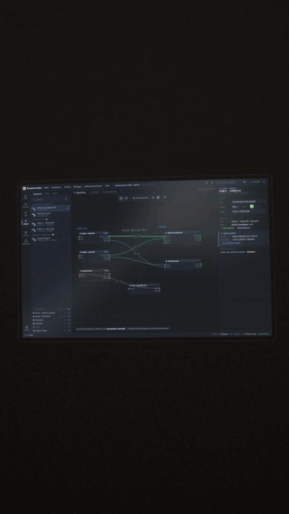
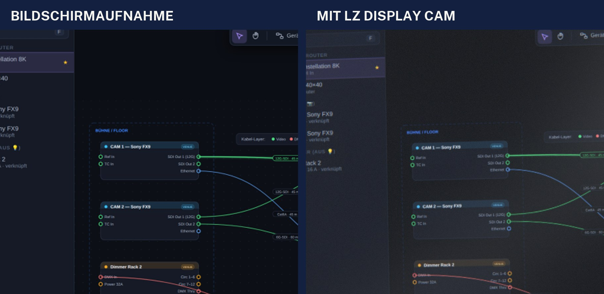

# LZ Display Cam

**Screen recordings that look filmed, not captured.**
A free DaVinci Resolve plugin that turns a clean screen recording into a hand-held shot of a real monitor: the subpixel moiré, the reflection of a window, the refresh bands, the slight wobble of a phone in your hand.

<p align="center">
  
</p>



[**Download for macOS**](https://github.com/larszu/lz-display-cam/releases/latest) · DaVinci Resolve 19.1 or newer · Apple Silicon and Intel

---

## Why

Product videos, tutorials and reels often show software. A plain screen recording looks flat and synthetic next to camera footage. Filming the monitor for real costs a setup, a tripod and a lot of retakes, and the text ends up unreadable.

LZ Display Cam gives you the filmed look and keeps the recording sharp underneath. You choose the shot afterwards, with keyframes, in the edit.

## What it simulates

Every effect follows the physics of a camera pointed at an LCD, not a texture laid on top.

| | |
|---|---|
| **Moiré** | The panel's RGB subpixel grid is sampled by the camera sensor. The beat pattern bends with the perspective and only appears at certain distances, like it does in real life. Softer focus dampens it. |
| **Reflection** | A soft window reflection on the matte panel. It slides against the camera movement (parallax). |
| **Refresh bands** | Dark bands from the rolling shutter reading rows while the backlight pulses. |
| **Hand-held camera** | Slow drift plus physiological tremor at 7–10 Hz. Rolling shutter turns it into the familiar jelly. |
| **Lens** | Perspective, distortion, chromatic aberration, depth of field, focus hunting, bloom, vignette. |
| **Sensor** | Exposure breathing, highlight roll-off, white balance, noise that grows with brightness. |
| **Room** | Monitor bezel with rounded corners in a dark room, all on one projection, so nothing slides against anything else. |

All of it is computed in linear light on the GPU (Metal). A 4K frame takes about 20 ms.

## Install

1. Download `LZ-Display-Cam-<version>.pkg` from the [latest release](https://github.com/larszu/lz-display-cam/releases/latest).
2. Open it. The package is not notarized: if macOS blocks it, go to **System Settings > Privacy & Security** and click **Open Anyway**.
3. Restart DaVinci Resolve.

The installer puts the plugin into `/Library/OFX/Plugins` and a DCTL version into Resolve's LUT folder.

## Use

1. Drag **Effects > OpenFX > LZ Medienproduktion > LZ Display Cam** onto your screen recording.
2. Pick a **Look**: *Handy, dezent* · *Handy, deutlich* · *Stativ, sauber* · *Gerade von vorn* · *Makro auf die Pixel*.
3. Set **Format der Aufnahme** to the aspect ratio of the recording (for example 16:10).
4. Frame the shot with **Zoom**, **Bildmitte X** and **Bildmitte Y**. Keyframe them for a camera move: `1.15` shows the whole monitor, `0.4–0.6` is a close-up where UI text stays readable in 9:16.

Every other control sits in a collapsible group: Aufstellung, Handkamera, Display, Spiegelung, Objektiv, Sensor, Umgebung. Hover a label for an explanation.

**Tip:** for vertical reels use a 2160 × 3840 timeline. Resolve scales the clip to the timeline before the effect runs, so close-ups stay sharp only with enough pixels.

## Also included

- **DCTL version** (`resolve/LZ_DisplayCam.dctl`): the same image model as a plain DCTL, for Resolve on Windows and Linux. Apply via *ResolveFX Color > DCTL*. Not as a LUT: the camera movement needs the timeline.
- **Command-line pipeline** (`skill/display-cam/`): records a web UI with Playwright and renders 9:16 reel scenes with captions in Python. Used by an automated video agent; runs without Resolve.

## Build from source

```bash
./ofx/build.sh                    # plugin bundle (needs Xcode command line tools and Resolve's OpenFX SDK)
./ofx/install.sh                  # copy into /Library/OFX/Plugins
./installer/build-pkg.sh 1.1.0    # installer package into dist/
python3 ofx/test/run.py image.png out.png p_Format=2 p_Zoom=0.5   # render a still on the GPU without Resolve
```

The DCTL is the single source of the image model; `ofx/gen.py` turns it into the Metal and CPU kernels and the plugin's controls.

## Deutsch

LZ Display Cam ist ein kostenloses Plugin für DaVinci Resolve. Es lässt eine Bildschirmaufnahme aussehen, als hätte eine Handkamera den Monitor abgefilmt: Moiré aus Panel- und Sensorraster, Fensterspiegelung, Refresh-Streifen, leichtes Wackeln, Objektiv und Sensorrauschen. Die Aufnahme bleibt darunter scharf; den Bildausschnitt wählst du im Schnitt per Keyframe.

Installieren: `.pkg` aus dem [neuesten Release](https://github.com/larszu/lz-display-cam/releases/latest) öffnen, Resolve neu starten, dann **Effekte > OpenFX > LZ Medienproduktion > LZ Display Cam** auf den Clip ziehen und oben einen Look wählen.

## Licence

Free to use, also commercially. Source available, not open source: see [LICENSE](LICENSE). Public Sans fonts under the SIL Open Font License.

Made by **Lars Zumpe Medienproduktion** · [zumpelars.de](https://zumpelars.de)
